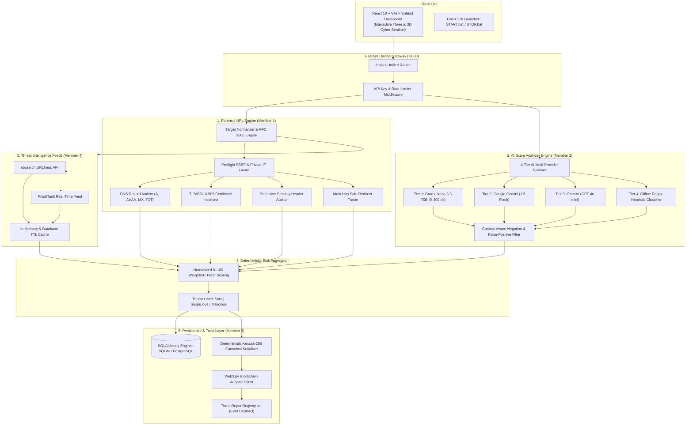

# CyberShield AI — Intelligent Web Threat Detection & Digital Trust Platform

[](docs/TEST_RESULTS.md)
[](docs/TEST_RESULTS.md)
[](frontend)
[](backend)
[](LICENSE)
[](docs/PROBLEM_STATEMENT_COMPLIANCE_AND_EVALUATION_REPORT.md)

**CyberShield AI** is an enterprise-grade cybersecurity analysis platform developed for the **Adamas Hackathon**. It establishes a zero-trust threat intelligence pipeline by uniting **deep technical website forensics**, **multi-tier AI social engineering & scam detection**, and **decentralized blockchain cryptographic report immutability**.

This repository (`CyberShield_AI_Version_2`) represents the complete production-integrated deliverable uniting all four team members' contributions into one verified, robust, and turnkey system.

---

## 🎯 Official Problem Statement Compliance

> **Official Problem Statement:** *AI-Powered Web Threat Detection & Digital Trust Intelligence*
>
> Modern cyber threats, credential harvesting phishing campaigns, and generative AI-driven financial scams operate at speeds beyond traditional signature-based security. Simultaneously, threat investigation records are vulnerable to retrospective tampering, data loss, and centralized spoofing.
>
> **The Solution:** CyberShield AI implements a multi-layered defense architecture that pairs preflight SSRF-safe URL forensics with a multi-model LLM scam analyzer, cross-referenced against live global threat intelligence (URLhaus, PhishTank), and irreversibly anchored to an EVM blockchain registry for cryptographic proof of origin and tamper-detection.

---

## 🏛️ System Architecture



---

## 👥 Four-Member Contribution Breakdown

| Team Member | Engineering Domain | Implemented Components | Deliverables & Key Files |
|---|---|---|---|
| **Member 1** | **Backend & Core Forensics** | • Preflight SSRF zero-outbound guard<br/>• DNS resolver (RFC conformance)<br/>• TLS/SSL X.509 certificate validation<br/>• Security headers analysis (CSP, HSTS, X-Frame)<br/>• 0–100 deterministic risk scoring engine | [`backend/app/services/scanner.py`](backend/app/services/scanner.py)<br/>[`backend/app/services/forensics.py`](backend/app/services/forensics.py)<br/>[`backend/threat_intel/normalization.py`](backend/threat_intel/normalization.py) |
| **Member 2** | **AI Message & Scam Engine** | • 4-tier LLM failover (Groq ➔ Gemini ➔ OpenAI ➔ Local)<br/>• Adversarial prompt injection defense<br/>• Evidence-based scam scoring<br/>• Context-aware negation handling<br/>• Legitimate bank email false-positive filter | [`backend/app/services/ai_engine/`](backend/app/services/ai_engine/)<br/>[`backend/threat_intel/services/reputation.py`](backend/threat_intel/services/reputation.py)<br/>[`docs/MESSAGE_INTELLIGENCE_SCORING_AND_CLASSIFICATION_AUDIT.md`](docs/MESSAGE_INTELLIGENCE_SCORING_AND_CLASSIFICATION_AUDIT.md) |
| **Member 3** | **Blockchain & Web3 Trust** | • `ThreatReportRegistry.sol` Solidity contract<br/>• Canonical JSON Keccak-256 hashing<br/>• Web3.py adapter with zero-dependency simulation<br/>• Hardhat 29-case contract & cross-language test suite<br/>• Cryptographic tamper detection verification | [`blockchain/contracts/ThreatReportRegistry.sol`](blockchain/contracts/ThreatReportRegistry.sol)<br/>[`blockchain/test/ThreatReportRegistry.test.js`](blockchain/test/ThreatReportRegistry.test.js)<br/>[`backend/app/services/blockchain.py`](backend/app/services/blockchain.py) |
| **Member 4** | **Frontend UI & Threat Intel** | • React 18 + TypeScript + Vite + Tailwind CSS<br/>• Three.js 3D interactive Cyber Sentinel<br/>• Live URLhaus & PhishTank provider integration<br/>• Scan history, telemetry charts & analytics<br/>• On-chain report verification modal | [`frontend/src/pages/`](frontend/src/pages/)<br/>[`frontend/src/components/`](frontend/src/components/)<br/>[`backend/threat_intel/providers/`](backend/threat_intel/providers/) |

---

## 🚀 Key Features

### 1. Forensic URL & Domain Scanner
- **Bare-Domain & Scheme Normalization:** Handles naked domains (`google.com`), internationalized domain names, and full URIs seamlessly.
- **SSRF & Private Network Guard:** Blocks resolution to loopback (`127.0.0.1`), private RFC 1918 subnets (`10.0.0.0/8`, `192.168.0.0/16`), and AWS/GCP metadata endpoints (`169.254.169.254`).
- **RFC 2606 Test Domain Intelligence:** Derives risk for synthetic domains (`.example`, `.test`, `.invalid`) through structural heuristics while explicitly indicating that external threat databases do not index non-routable namespaces.
- **Compound Phishing Heuristics:** Detects high-risk lures across registered domains and paths (`account-suspended`, `secure-bank-login`, `wallet-verify`).

### 2. AI Message & Scam Intelligence
- **4-Tier LLM Multi-Provider Architecture:**
  1. *Tier 1 (Groq Cloud):* Ultra-fast sub-second Llama 3.3 70B inference.
  2. *Tier 2 (Google Gemini):* Gemini 1.5 Flash multimodal fallback.
  3. *Tier 3 (OpenAI):* GPT-4o mini contingency.
  4. *Tier 4 (Offline Regex Engine):* Zero-network deterministic heuristic scoring.
- **Scam Category Classifications:** Job recruitment scams, cryptocurrency investment fraud, lottery lures, OTP phishing, and executive impersonation.
- **Zero-False-Positive Banking Filter:** Detects advisory negation language ("we will never ask for your PIN/OTP", "if you recognize this activity, no action is required") to safeguard legitimate transactional notifications.

### 3. Decentralized Web3 Blockchain Registry
- **Cryptographic Immutability:** Threat reports are canonicalized and hashed using Keccak-256 (`bytes32`).
- **Solidity Smart Contract (`ThreatReportRegistry.sol`):** Stores report ID, threat score, categorization, timestamp, and registrant address.
- **Dual Verification Modes:**
  - *Live EVM Mode:* Connects to local Hardhat node or public testnet (Sepolia/Polygon Amoy).
  - *Simulation Mode:* Operates with zero external blockchain dependencies while maintaining full cryptographic hash integrity.

---

## 🛠️ Technology Stack

| Layer | Technologies |
|---|---|
| **Backend API** | Python 3.11, FastAPI 0.115, Pydantic v2, Uvicorn, SQLAlchemy |
| **Frontend UI** | React 18, TypeScript 5, Vite, Tailwind CSS, Lucide Icons, Three.js |
| **Blockchain** | Solidity ^0.8.20, Hardhat, Ethers.js v6, Web3.py v6 |
| **Forensics & Networking** | dnspython, cryptography (X.509), httpx, Starlette |
| **Threat Intelligence** | abuse.ch URLhaus API, PhishTank REST API |
| **AI / LLM Providers** | Groq Cloud (Llama 3.3), Google Generative AI (Gemini), OpenAI |
| **Testing** | Pytest, Pytest-Asyncio, Hardhat Test Runner, Vite Build Compiler |

---

## ⚡ Quick Start (Windows One-Click)

Launch the complete application with a single click:

```cmd
START.bat
```

What `START.bat` does automatically:
1. Validates Python 3.11+ and Node.js environments.
2. Checks port availability (Backend `8000`, Frontend `5173`).
3. Launches the FastAPI backend in a dedicated, live-logging console window.
4. Launches the Vite development server in a separate titled window.
5. Launches your default web browser to `http://localhost:5173`.

To cleanly terminate all running servers:
```cmd
STOP.bat
```

---

## 💻 Manual Installation & Launch

### Prerequisites
- **Python:** 3.11 or higher
- **Node.js:** v18 or higher (with npm)
- **Git**

### 1. Clone & Setup Environment
```bash
git clone https://github.com/RupanjanDutta2006/CyberShield_AI_Version_2.git
cd CyberShield_AI_Version_2

# Copy environment configuration
cp .env.example backend/.env
cp .env.example frontend/.env
```

### 2. Backend Setup
```bash
cd backend
python -m pip install -r requirements.txt
python -m uvicorn app.main:app --host 127.0.0.1 --port 8000 --reload
```
- API Base: `http://127.0.0.1:8000`
- Swagger Documentation: `http://127.0.0.1:8000/docs`
- ReDoc Explorer: `http://127.0.0.1:8000/redoc`

### 3. Frontend Setup
```bash
cd frontend
npm install
npm run dev
```
- Web Application: `http://localhost:5173`

### 4. (Optional) Local Blockchain EVM Node
```bash
cd blockchain
npm install
npx hardhat node
# In a separate terminal, deploy the registry:
npx hardhat run scripts/deploy.js --network localhost
```
*(If omitted, CyberShield AI automatically runs in Zero-Dependency Blockchain Simulation Mode).*

---

## 🧪 Comprehensive Verification & Test Suite

The repository includes a comprehensive, dual-layer automated test suite:

```cmd
RUN_TESTS.bat
```

### Verified Test Results Summary

| Test Layer | Test Runner | Total Tests | Passed | Failed | Execution Time | Status |
|---|---|---|---|---|---|:---:|
| **Backend Core Suite** | `pytest backend/tests` | **415** | **415** | **0** | ~48.4s | **PASSED** |
| • *URL Scanner Audit* | `pytest test_url_scanner_audit.py` | 18 | 18 | 0 | 35.1s | **PASSED** |
| • *Message Intel Audit* | `pytest test_message_intelligence_audit.py` | 16 | 16 | 0 | 4.9s | **PASSED** |
| • *Live EVM Integration* | `python verify_live_evm.py` | 4 | 4 | 0 | 1.8s | **PASSED** |
| **Blockchain Smart Contract** | `npx hardhat test` | **29** | **29** | **0** | 694ms | **PASSED** |
| **Frontend Production Build** | `npm run build` | 2,162 modules | 100% | 0 | 4.5s | **PASSED** |

---

## 📡 REST API Reference

| Method | Endpoint | Description |
|:---:|---|---|
| `POST` | `/api/v1/scans/url` | Comprehensive website forensic analysis (DNS, TLS, SSRF, Threat Intel). |
| `POST` | `/api/v1/scans/message` | AI-driven email and text scam analysis with prompt injection defense. |
| `GET` | `/api/v1/scans` | Paginated scan history with threat classifications and scores. |
| `GET` | `/api/v1/scans/{scan_id}` | Detailed telemetry and cryptographic proof for an individual scan. |
| `POST` | `/api/v1/reports/{report_id}/verify` | Cryptographic report integrity validation and on-chain check. |
| `GET` | `/api/v1/system/status` | Real-time health status of Database, AI Providers, Feeds, and Web3 RPC. |
| `GET` | `/api/v1/stats` | High-level metrics for dashboard visualization. |
| `POST` | `/api/v1/url/preflight` | Instant SSRF check and URL normalization. |
| `POST` | `/api/v1/reports/register` | Anchors canonical report hash into `ThreatReportRegistry.sol`. |

For complete request payloads, schema models, and response formats, see [`docs/API_INTEGRATION_DOCUMENTATION.md`](docs/API_INTEGRATION_DOCUMENTATION.md).

---

## 📚 Technical Documentation Directory

Comprehensive engineering audit reports and architectural assessments are maintained in the [`docs/`](docs/) directory:

- 📑 **[Problem Statement Compliance & Evaluation Report](docs/PROBLEM_STATEMENT_COMPLIANCE_AND_EVALUATION_REPORT.md)** — Official 91.5/100 hackathon evaluation matrix.
- 🔍 **[URL & Domain Reputation Scanner Audit & Fix Report](docs/URL_DOMAIN_SCANNER_AUDIT_AND_FIX_REPORT.md)** — Root-cause fixes for 500 errors and synthetic domain detection.
- 🤖 **[Message Intelligence Scoring & Classification Audit](docs/MESSAGE_INTELLIGENCE_SCORING_AND_CLASSIFICATION_AUDIT.md)** — Investigation of scam detection across synthetic emails.
- 🏦 **[Bank Email False-Positive Investigation Report](docs/MESSAGE_INTELLIGENCE_BANK_EMAIL_FALSE_POSITIVE_FIX_REPORT.md)** — Negation handling and contextual threat calibration.
- ⚙️ **[Member 1–3 Technical Assessment](docs/MEMBER_1_3_TECHNICAL_ASSESSMENT.md)** — Backend and blockchain architectural review.
- 🤝 **[Member 1–3 Final Handoff Report](docs/MEMBER_1_3_FINAL_HANDOFF_REPORT.md)** — Cryptographic hashing and EVM contract integration.
- 🧠 **[Member 2–4 Engineering Assessment](docs/MEMBER_2_4_ENGINEERING_ASSESSMENT.md)** — AI engine failover and Threat Intelligence feed architecture.
- 📋 **[Final Integration Report](docs/FINAL_INTEGRATION_REPORT.md)** — Unified repository architecture and schema mappings.
- 🔒 **[Security & Known Limitations](docs/KNOWN_ISSUES.md)** — Operational limits, rate-limit guidelines, and gas configurations.

---

## 🔒 Security & Safe Operation

- **Zero Secret Commitment:** No real API keys, seed phrases, private keys, or `.env` files are tracked in this repository.
- **Configurable Fallbacks:** Operates seamlessly even if commercial AI APIs (Groq, Gemini, OpenAI) or public blockchain RPCs are offline.
- **SSRF Hardening:** Strict preflight checks eliminate malicious outbound SSRF probes to internal infrastructure.
- **Database Privacy:** Local SQLite databases (`*.db`, `*.sqlite`) are ignored by version control to protect user telemetry.

---

## 📄 License

This project is licensed under the **MIT License** — see the [LICENSE](LICENSE) file for details.

Copyright (c) 2026 Rupanjan Dutta. Built for the **Adamas Hackathon 2026**.
