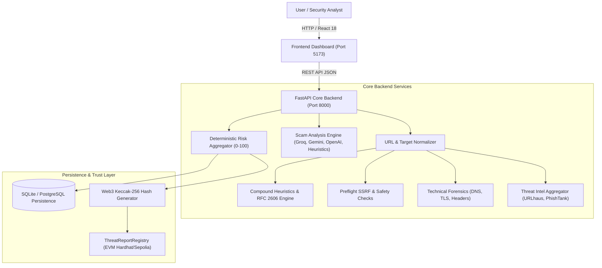

# CyberShield AI — Technical Documentation & Architecture Directory

This directory contains the complete technical audit reports, architecture specifications, compliance evaluations, and engineering assessments produced during the four-member integration of CyberShield AI.

---

## 📑 Technical Reports Index

| Document | Focus & Scope | Key Milestones & Metrics |
|---|---|---|
| [PROBLEM_STATEMENT_COMPLIANCE_AND_EVALUATION_REPORT.md](./PROBLEM_STATEMENT_COMPLIANCE_AND_EVALUATION_REPORT.md) | Official Hackathon Problem Statement evaluation | Independent audit scoring 91.5 / 100 with comprehensive requirement tracing across all 4 tracks. |
| [URL_DOMAIN_SCANNER_AUDIT_AND_FIX_REPORT.md](./URL_DOMAIN_SCANNER_AUDIT_AND_FIX_REPORT.md) | Forensic URL & Domain Scanner deep-dive | Resolved bare-domain 500 error, added RFC 2606 test domain detection, compound phishing heuristics (18/18 tests passed). |
| [MESSAGE_INTELLIGENCE_SCORING_AND_CLASSIFICATION_AUDIT.md](./MESSAGE_INTELLIGENCE_SCORING_AND_CLASSIFICATION_AUDIT.md) | AI Message & Scam Intelligence Pipeline | Addressed job recruitment, lottery/investment, and OTP phishing scam detection (16/16 tests passed). |
| [MESSAGE_INTELLIGENCE_BANK_EMAIL_FALSE_POSITIVE_FIX_REPORT.md](./MESSAGE_INTELLIGENCE_BANK_EMAIL_FALSE_POSITIVE_FIX_REPORT.md) | Banking Email False-Positive Investigation | Fixed negative context scoring for legitimate bank activity alerts (reduced false threat score from 74 to Low Risk). |
| [MEMBER_1_3_TECHNICAL_ASSESSMENT.md](./MEMBER_1_3_TECHNICAL_ASSESSMENT.md) | Member 1 (Backend) & Member 3 (Blockchain) Source Audit | Compatibility review of URL scanner, database schemas, and Ethereum smart contract ABI. |
| [MEMBER_1_3_FINAL_HANDOFF_REPORT.md](./MEMBER_1_3_FINAL_HANDOFF_REPORT.md) | Member 1 & 3 Merge Verification | Initial verification of smart contract cryptographic hashing and backend preflight integration. |
| [MEMBER_2_4_ENGINEERING_ASSESSMENT.md](./MEMBER_2_4_ENGINEERING_ASSESSMENT.md) | Member 2 (AI Scam Engine) & Member 4 (Threat Intel) | AI engine multi-provider failover, Threat Intelligence provider feeds (URLhaus/PhishTank), and 3D visualization. |
| [FINAL_INTEGRATION_REPORT.md](./FINAL_INTEGRATION_REPORT.md) | Four-Member Unification Report | Unified workspace composition, shared schemas, port alignment, and system health checks. |
| [FINAL_VERIFICATION_REPORT.md](./FINAL_VERIFICATION_REPORT.md) | Independent Technical Verification | Re-execution and cross-validation of 415 backend tests and 29 Hardhat blockchain tests. |
| [API_INTEGRATION_DOCUMENTATION.md](./API_INTEGRATION_DOCUMENTATION.md) | REST API Contract Specification | Endpoints for URL scans, message analysis, blockchain verification, scan history, and system health. |
| [TEST_RESULTS.md](./TEST_RESULTS.md) | Automated Test Results Log | Detailed execution outputs for unit, integration, and contract test suites. |
| [KNOWN_ISSUES.md](./KNOWN_ISSUES.md) | Architecture Boundaries & Operational Limits | Live threat feed rate limits, public testnet gas fees, and browser-specific CSP notes. |

---

## 🏛️ System Architecture At a Glance

